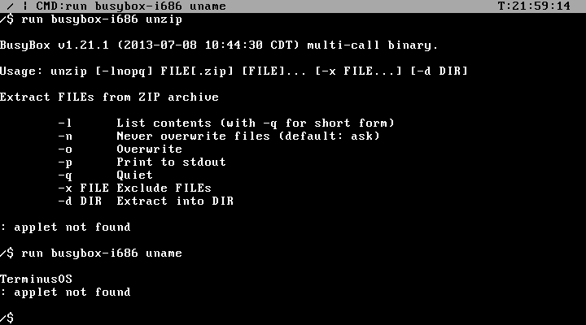
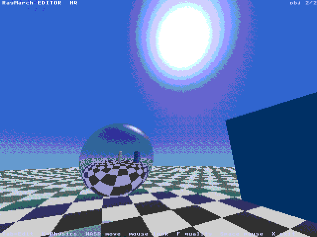
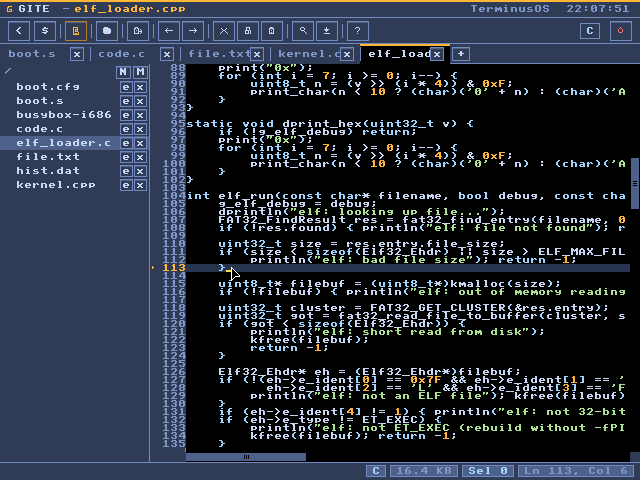
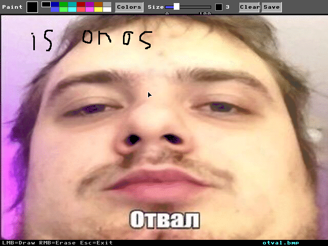
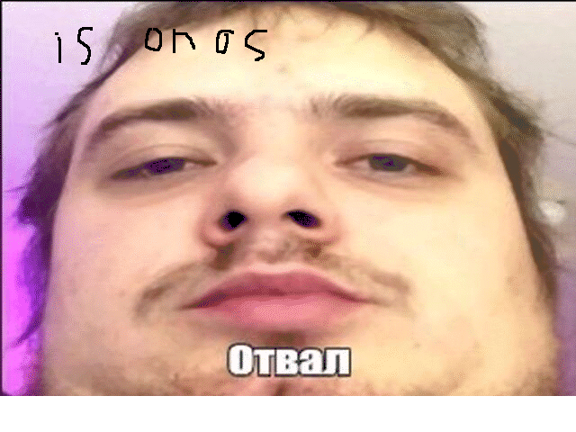
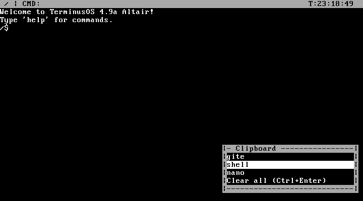
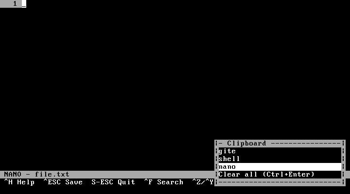
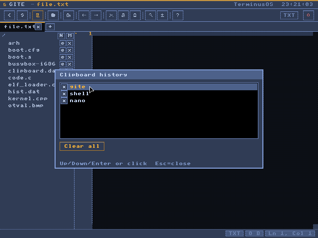
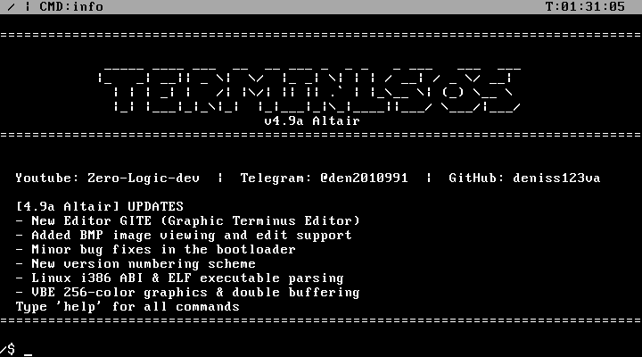

# 🛠 TerminusOS v4.9a "Altair" — Userspace & GITE Update

> Major release: TerminusOS can now run real ELF programs through a Linux-compatible syscall ABI, gets a graphical text editor **GITE**, a BMP image viewer, a clipboard history, and a bootloader that finally works on real hardware.

> ℹ️ Versioning has changed: `0.4.7` → `4.9a`. Every release now has a codename — this one is **Altair**.

---

## 🧩 Run Real Programs — ELF Loader & Linux ABI

TerminusOS can now run programs that were **not written for it**. Static i386 ELF binaries (musl, and some glibc) are loaded into memory and talk to the kernel through the Linux i386 syscall ABI (`int 0x80`) — file I/O, memory (`brk`, `mmap`), time, TLS, `uname` and more. Even **BusyBox** runs.

```Shell
run <program.elf>
run -d <program.elf>     # trace every syscall
```



On top of the Linux ABI there are **Terminus extensions** (syscalls 1000+) that give userspace programs access to graphics, mouse and keyboard — double-buffered drawing, 256-color palette, direct backbuffer access, mouse position/buttons, a held-keys bitmask for games. A header with ready-made wrappers lives in `userspace/terminus_gfx.h`.

Samples in `userspace/`:

- **`raymarch_editor`** — ray-marching scene editor (spawn objects, motion modes, materials)
- **`arh`** — a tiny system-info program

#### raymarch_editor.elf


#### arh.elf


Under the hood: extended GDT with TLS, a 100 Hz PIT timer, and a real heap with integrity checking. Press **Ctrl+C** to kill a running program.

---

## ✏️ GITE — Graphic Terminus Editor

A new **graphical text editor** for 640×480 with full mouse support. The editing engine comes from Nano, everything else is new:

- **Tabs** — several files open at once
- **File panel** and a **built-in terminal**, both toggleable
- **Undo / Redo**, selection, **Find & Replace**, **Go to line**, jump by word
- **Open / Save / Save as / New file / New folder / Rename**
- **Syntax highlighting** and a custom color theme
- Shares the new **clipboard history** with the shell

```Shell
gite [file]
```



---

## 🖼 BMP Viewer & Paint

The new **`image`** command opens BMP pictures. The old `gui` app is now called **`paint`** and can **load and save BMP files**.

```Shell
paint otval.bmp
image otval.bmp
```

Graphics got a full **256-color palette** (16 VGA colors, 16 greys, a 6×6×6 RGB cube, 8 extra greys), and the mouse cursor is now drawn into the backbuffer, so there is less flicker.

#### paint


#### image

---

## 📋 Clipboard History & Better Shell

Press **`Win+V`** in the shell to open a **clipboard history panel** — the last 8 copied or cut entries, shared between the shell and GITE and nano, saved to disk and restored after reboot.

#### in shell


#### in nano


#### in GITE


Also new in the shell:

- **`Ctrl+←/→`** jump by word, **`Ctrl+Backspace`** deletes a word
- **`Shift+←/→`** select symbol, **`Ctrl+Shift+←/→`** select word, **`Ctrl+V`** to paste **`Ctrl+C`** to copy, and **`Ctrl+X`** to cut
- **ANSI/VT100 escape codes** are understood (cursor movement, clearing, colors) — enough for BusyBox tools
- **`mv file /dir`** now correctly moves a file *into* a directory
- **`meminfo`** also shows heap usage and integrity
- **`info`** shows the version, codename and the list of updates



---

## 💾 Works on Real Hardware

The bootloader was reworked after testing on an old PC:

- Disk is read in **CHS mode only** — Extended LBA BIOS calls hung or rebooted some machines
- Stage 1 prints `1` → `G` → `2` while booting, so you can see where a stubborn machine stops
- **ATA/ATAPI timeouts are much longer** — real spinning disks are slower than QEMU
- Fixed mouse movement loss on fast flicks, and Ctrl+C detection while a program runs

---

## 🧰 For Developers

- **`tfsutil`** — host tool for TerminusOS disk images: `info`, `ls`, `cat`, `extract`, `format`, `add`, `mkdir`, `rm`
- **`syscalls.md`** — syscall reference

```Shell
./build.sh        # both ISO and disk.img
./build.sh disk   # disk.img only
./build.sh iso    # ISO only
```

> Use `-m 128` or more RAM in QEMU — user programs live above 64 MB. (Better 256MB RAM)

---

## 👨‍💻 Author

- **YouTube:** [Zero Logic](https://www.youtube.com/@Zero-Logic-dev)
- **Telegram:** [@Terminus_dev](https://telegram.me/Terminus_dev)
